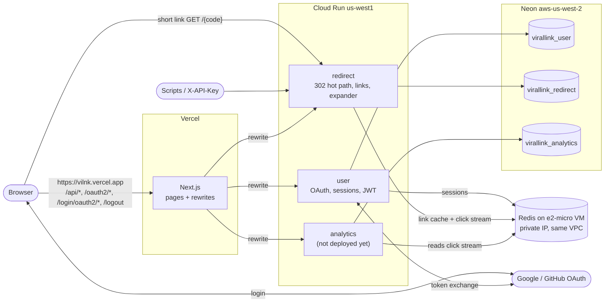

# Deploying Virallink

How the live setup is built, step by step, with the exact commands that worked and the pitfalls hit on the way.
Local development is unchanged: every setting falls back to its `localhost` value ([LOCAL_DEV.md](./LOCAL_DEV.md)).

**Live setup (Oct 2026)**

| Piece | Where | Address / name |
|---|---|---|
| Frontend | Vercel (Hobby), project `viral-analytics-hub` | `https://vilnk.vercel.app` |
| user, redirect | Cloud Run, `us-west1`, project `virallink-487806` | `https://user-85302724166.us-west1.run.app`, `https://redirect-85302724166.us-west1.run.app` |
| analytics | **not deployed yet** (see [Analytics](#analytics-not-deployed-yet)) | |
| PostgreSQL | Neon, `aws-us-west-2`, branch `production` | databases `virallink_user`, `virallink_redirect`, `virallink_analytics` |
| Redis | free `e2-micro` VM `virallink-redis`, `us-west1-b`, private IP only | `10.138.0.2:6379` |
| Images | Artifact Registry `us-west1-docker.pkg.dev/virallink-487806/virallink` | `user:<tag>`, `redirect:<tag>` |
| Secrets | Secret Manager | see [Secrets](#secrets) |

Everything sits in **Oregon** (`us-west1` / Neon `aws-us-west-2`): the closest free-tier VM region to Korea, and
Cloud Run, Redis and the database stay next to each other.

- [Architecture](#architecture)
- [Environment variables](#environment-variables)
- [1. Neon](#1-neon)
- [2. Redis on a free VM](#2-redis-on-a-free-vm)
- [3. OAuth apps](#3-oauth-apps)
- [4. GCP setup and secrets](#4-gcp-setup-and-secrets)
- [5. Build and deploy the services](#5-build-and-deploy-the-services)
- [6. Vercel](#6-vercel)
- [7. Check it works](#7-check-it-works)
- [Updating a service](#updating-a-service)
- [Automatic deploys (Cloud Build triggers)](#automatic-deploys-cloud-build-triggers)
- [Analytics (not deployed yet)](#analytics-not-deployed-yet)
- [Pitfalls we hit](#pitfalls-we-hit)
- [Cost](#cost)
- [Known risks](#known-risks)

---

## Architecture



- **The browser only talks to `vilnk.vercel.app`** (plus the redirect service for short links). Vercel forwards
  `/api/*`, `/oauth2/*`, `/login/oauth2/*` and `/logout` to the services (`viral-analytics-hub/next.config.ts`).
  That keeps the login cookie (`SESSION`) on the Vercel domain, where the dashboard can use it. Login must start and
  return through Vercel; see [Pitfalls](#pitfalls-we-hit).
- Short links go **directly** to the redirect service: faster, and it sees the visitor's real IP.
- Cloud Run reaches Redis over the VPC (Direct VPC egress); the VM has no public IP.

## Environment variables

Secrets live in **Secret Manager** and are attached with `--set-secrets` (the command only names the secret, never
the value). Plain values go in `--set-env-vars`. `PORT` is set by Cloud Run; never set it.

| Variable | Secret | user | redirect | analytics | Value |
|---|:-:|:-:|:-:|:-:|---|
| `SPRING_PROFILES_ACTIVE` | | ✓ | ✓ | ✓ | `prod` |
| `DB_URL` | | ✓ | ✓ | ✓ | `jdbc:postgresql://<neon host>/virallink_<service>?sslmode=require` (analytics: add `&reWriteBatchedInserts=true`) |
| `DB_USERNAME` | | ✓ | ✓ | ✓ | `neondb_owner` |
| `DB_PASSWORD` | ✓ `DB_PASSWORD` | ✓ | ✓ | ✓ | Neon role password |
| `REDIS_HOST` / `REDIS_PORT` / `REDIS_SSL` | | ✓ | ✓ | ✓ | `10.138.0.2` / `6379` / `false` |
| `REDIS_PASSWORD` | ✓ `redis-password` | ✓ | ✓ | ✓ | from the VM's `redis.conf` |
| `JWT_SECRET` | ✓ `jwt-secret` | ✓ | ✓ | ✓ | **same in all three** |
| `API_KEY_SIGNING_SECRET` | ✓ `api-key-signing-secret` | ✓ | ✓ | | **same in user and redirect** |
| `FRONTEND_URL` | | ✓ | | | `https://vilnk.vercel.app` (no trailing slash) |
| `GOOGLE_CLIENT_ID` / `GITHUB_CLIENT_ID` | | ✓ | | | OAuth client IDs (both required: the service won't start with an empty one) |
| `GOOGLE_CLIENT_SECRET` / `GITHUB_CLIENT_SECRET` | ✓ `google-client-secret`, `github-client-secret` | ✓ | | | |
| `HASHIDS_SALT` | ✓ `hashids-salt` | | ✓ | | **never change it**: every existing short code would break |
| `SAFE_BROWSING_API_KEY` | ✓ | | ✓ | | optional; without it link creation and the expander skip the Safe Browsing check |
| `OAUTH2_REDIRECT_BASE_URL` | | (✓) | | | optional, defaults to `FRONTEND_URL` |
| `JWT_EXPIRATION_MS` | | (✓) | | | optional, default `3600000` (1 hour) |
| `DB_POOL_MAX_SIZE` | | (✓) | (✓) | (✓) | optional, default `5` |
| `GEOLITE_PATH` | | | | (✓) | set in the image; override when mounting the file |

Instead of the four `REDIS_*` values you can set one secret `SPRING_DATA_REDIS_URL` (`redis://:<password>@<host>:6379`).

**Vercel** (Project → Settings → Environment Variables, environment **Production**, not "Sensitive"; all are public
URLs and are read at **build time**, so changes need a redeploy):

| Variable | Value |
|---|---|
| `NEXT_PUBLIC_API_BASE_URL` | `https://vilnk.vercel.app` (**the Vercel site itself**, not the user service) |
| `NEXT_PUBLIC_SHORT_LINK_BASE_URL` | `https://redirect-85302724166.us-west1.run.app` |
| `USER_SERVICE_URL` | `https://user-85302724166.us-west1.run.app` |
| `REDIRECT_SERVICE_URL` | `https://redirect-85302724166.us-west1.run.app` |
| `ANALYTICS_SERVICE_URL` | add once analytics is deployed |

## 1. Neon

1. Create a project in **AWS us-west-2 (Oregon)**.
2. **Databases → Add database** three times: `virallink_user`, `virallink_redirect`, `virallink_analytics`, owner
   `neondb_owner`. Copy-paste the names (a typo, `virallink_redierct`, cost us a failed deploy).
3. **Connect**, with **Connection pooling off** (direct connection): note the host (`ep-…us-west-2.aws.neon.tech`),
   the role and the password. Never paste the full connection string anywhere public: it contains the password.

Tables are created by the services on first start (`ddl-auto=update`; see [Known risks](#known-risks)). Use the
direct host: the services run schema changes at startup, which a pooled connection handles badly, and the pools are
small (5 per instance).

## 2. Redis on a free VM

The free `e2-micro` exists only in `us-west1`, `us-central1` and `us-east1`, with a standard disk up to 30 GB.

```bash
gcloud compute instances create virallink-redis \
  --zone=us-west1-b --machine-type=e2-micro \
  --image-family=debian-12 --image-project=debian-cloud \
  --boot-disk-size=30GB --boot-disk-type=pd-standard
```

On the VM (`gcloud compute ssh virallink-redis --zone=us-west1-b`):

```bash
sudo apt-get update && sudo apt-get install -y redis-server
REDIS_PW=$(openssl rand -hex 24); echo "SAVE THIS: $REDIS_PW"
sudo tee -a /etc/redis/redis.conf <<EOF
bind 0.0.0.0
requirepass $REDIS_PW
appendonly yes
maxmemory 256mb
maxmemory-policy noeviction
EOF
sudo systemctl restart redis-server
redis-cli -a "$REDIS_PW" --no-auth-warning ping      # PONG
exit
```

- `appendonly yes` keeps queued clicks and login sessions across restarts; `noeviction` stops Redis from dropping
  the click stream when memory is tight.
- Lost the password? `sudo grep '^requirepass' /etc/redis/redis.conf` on the VM (last line wins).

Back in Cloud Shell, remove the public IP (only needed for `apt-get`; it also costs money) and note the private IP:

```bash
ZONE=us-west1-b
gcloud compute instances delete-access-config virallink-redis --zone=$ZONE --access-config-name="external-nat"
gcloud compute instances describe virallink-redis --zone=$ZONE --format='value(networkInterfaces[0].networkIP)'
```

Without a public IP, SSH goes through Google's tunnel: `gcloud compute ssh virallink-redis --zone=$ZONE --tunnel-through-iap`.
For OS updates, temporarily re-add a public IP with `gcloud compute instances add-access-config`.

Cloud Run reaches the VM with `--network=default --subnet=default --vpc-egress=private-ranges-only` (step 5); the
default network's firewall already allows internal traffic. No TLS needed: traffic stays on the private network.

Other Redis options, if the VM becomes a chore: Upstash fixed plan (~$10/month; the free 500K commands/month are not
enough while analytics polls), Memorystore (~$36/month minimum). Any Redis works if it supports Streams with consumer
groups, has persistence on and does not evict keys without a TTL.

## 3. OAuth apps

The callback addresses are on the **Vercel site**, not on Cloud Run (the login cookie lives there):

- Google: `https://vilnk.vercel.app/login/oauth2/code/google`
- GitHub: `https://vilnk.vercel.app/login/oauth2/code/github`

**Google** (console.cloud.google.com → APIs & Services): set up the OAuth consent screen (External; scopes
`openid`, `email`, `profile`), then Credentials → Create credentials → OAuth client ID → Web application, with the
redirect URI above. Copy the client ID and secret right away.
While the app is in **Testing**, only listed test users can sign in. To open it to everyone: Google Auth Platform
(OAuth consent screen) → **Audience** → **Publish app**. With only these basic scopes no Google review is needed.

**GitHub** (Settings → Developer settings → OAuth Apps → New OAuth App): a separate app for production (one
callback URL per app). Homepage `https://vilnk.vercel.app`, callback as above; **Generate a new client secret** and
copy it (shown once).

## 4. GCP setup and secrets

In Cloud Shell (project `virallink-487806`):

```bash
gcloud services enable run.googleapis.com artifactregistry.googleapis.com cloudbuild.googleapis.com \
  secretmanager.googleapis.com compute.googleapis.com
gcloud artifacts repositories create virallink --repository-format=docker --location=us-west1

# Runtime identity of the services: reads secrets, nothing else
gcloud iam service-accounts create virallink-run --display-name="Virallink Cloud Run runtime"
RUN_SA=virallink-run@virallink-487806.iam.gserviceaccount.com
```

### Secrets

Paste values with `read -rs` (hidden, not saved in shell history). After each `read` line, paste and press Enter.
**Paste the real value, never the `<...>` placeholder text**: that happened once and broke Redis auth.

```bash
read -rs V && printf '%s' "$V" | gcloud secrets create DB_PASSWORD --data-file=-            # Neon password
read -rs V && printf '%s' "$V" | gcloud secrets create redis-password --data-file=-         # from redis.conf
read -rs V && printf '%s' "$V" | gcloud secrets create google-client-secret --data-file=-
read -rs V && printf '%s' "$V" | gcloud secrets create github-client-secret --data-file=-
unset V
printf '%s' "$(openssl rand -base64 32)" | gcloud secrets create jwt-secret --data-file=-
printf '%s' "$(openssl rand -base64 32)" | gcloud secrets create api-key-signing-secret --data-file=-
printf '%s' "$(openssl rand -hex 16)"    | gcloud secrets create hashids-salt --data-file=-

for s in DB_PASSWORD redis-password google-client-secret github-client-secret jwt-secret api-key-signing-secret hashids-salt; do
  gcloud secrets add-iam-policy-binding $s --member=serviceAccount:$RUN_SA --role=roles/secretmanager.secretAccessor
done
```

- `gcloud secrets list` shows names only. To check a value: `gcloud secrets versions access latest --secret=<name>`.
- To change one: `read -rs V && printf '%s' "$V" | gcloud secrets versions add <name> --data-file=-` (`:latest`
  picks it up at the next deploy/restart), then optionally `gcloud secrets versions disable 1 --secret=<name>`.

## 5. Build and deploy the services

Get the code into Cloud Shell and build with Cloud Build. `gcloud builds submit` uploads one service folder, runs its
Dockerfile on Google's machines and stores the image in Artifact Registry:

```bash
cd ~ && git clone https://github.com/ehdro06/viral-analytics-hub.git && cd viral-analytics-hub
git checkout main && git pull
gcloud builds submit ./user     --tag us-west1-docker.pkg.dev/virallink-487806/virallink/user:v1
gcloud builds submit ./redirect --tag us-west1-docker.pkg.dev/virallink-487806/virallink/redirect:v1
```

First deploy (this sets everything; later deploys only change the image). `gcloud run deploy` is the command-line
version of the console's "Create service" form:

```bash
RUN_SA=virallink-run@virallink-487806.iam.gserviceaccount.com
NEON=ep-misty-forest-arzle9a2.c-4.us-west-2.aws.neon.tech
COMMON="--region=us-west1 --service-account=$RUN_SA --allow-unauthenticated --memory=1Gi --cpu=1 --cpu-boost \
  --network=default --subnet=default --vpc-egress=private-ranges-only"

gcloud run deploy user --image=us-west1-docker.pkg.dev/virallink-487806/virallink/user:v1 $COMMON \
  --min-instances=0 --max-instances=3 \
  --set-env-vars="SPRING_PROFILES_ACTIVE=prod,DB_URL=jdbc:postgresql://$NEON/virallink_user?sslmode=require,DB_USERNAME=neondb_owner,REDIS_HOST=10.138.0.2,REDIS_PORT=6379,REDIS_SSL=false,FRONTEND_URL=https://vilnk.vercel.app,GOOGLE_CLIENT_ID=<google client id>,GITHUB_CLIENT_ID=<github client id>" \
  --set-secrets="DB_PASSWORD=DB_PASSWORD:latest,REDIS_PASSWORD=redis-password:latest,JWT_SECRET=jwt-secret:latest,API_KEY_SIGNING_SECRET=api-key-signing-secret:latest,GOOGLE_CLIENT_SECRET=google-client-secret:latest,GITHUB_CLIENT_SECRET=github-client-secret:latest"

gcloud run deploy redirect --image=us-west1-docker.pkg.dev/virallink-487806/virallink/redirect:v1 $COMMON \
  --min-instances=0 --max-instances=3 \
  --set-env-vars="SPRING_PROFILES_ACTIVE=prod,DB_URL=jdbc:postgresql://$NEON/virallink_redirect?sslmode=require,DB_USERNAME=neondb_owner,REDIS_HOST=10.138.0.2,REDIS_PORT=6379,REDIS_SSL=false" \
  --set-secrets="DB_PASSWORD=DB_PASSWORD:latest,REDIS_PASSWORD=redis-password:latest,JWT_SECRET=jwt-secret:latest,API_KEY_SIGNING_SECRET=api-key-signing-secret:latest,HASHIDS_SALT=hashids-salt:latest"
```

Replace both `<...>` client IDs with the real values (no angle brackets: a leftover placeholder in `FRONTEND_URL`
made every user-service request fail with "Bad authority").

- `--allow-unauthenticated`: Vercel's forwarding and short-link visitors are anonymous; the apps check logins themselves.
- `--min-instances=0` keeps it free; the first request after idle waits ~15-30 s for Java to start. Set redirect to
  `1` once real people click links.
- Change a single setting later without rebuilding: `gcloud run services update <service> --region=us-west1 --update-env-vars="KEY=value"`.
- The same settings are editable in the console: Cloud Run → service → **Edit & deploy new revision**.

## 6. Vercel

1. **Add New → Project**, import the repo. **Root Directory** `viral-analytics-hub`, framework Next.js, Node.js 22.x.
2. Add the environment variables from [the table above](#environment-variables) (environment **Production**).
3. **Domains:** add `vilnk.vercel.app` and make sure it is attached to **Production**, not to a git branch. (Ours was
   attached to the deploy branch: it then served preview builds, which get no Production variables, so the login
   button pointed at `localhost:8080`, and previews are protected, so visitors saw a Vercel login wall.)
4. **Settings → Environments → Production → Branch Tracking:** `main`.
5. **Deployment Protection:** standard protection (previews protected, production public).
6. Deploy. After changing any variable: Deployments → latest Production → ⋯ → **Redeploy** with **"Use existing
   Build Cache" unticked** (`NEXT_PUBLIC_*` values are baked into the build).

Vercel deploys `main` automatically on every merge.

## 7. Check it works

```bash
curl -s https://user-85302724166.us-west1.run.app/actuator/health; echo       # {"groups":[...],"status":"UP"}
curl -s https://redirect-85302724166.us-west1.run.app/actuator/health; echo
curl -sI https://vilnk.vercel.app/oauth2/authorization/google | grep -iE "^location|^set-cookie"
```

- Always include `https://` (plain `http://` returns an empty redirect) and check the region spelling (`us-west1`).
- The Location header must contain `redirect_uri=https://vilnk.vercel.app/login/oauth2/code/google`; the cookie
  must be `SESSION=…; Secure; HttpOnly`.

Then in an incognito window: log in with Google and GitHub (you land on `/dashboard`), create a link, open it, open
Settings, log out. Dashboard charts show errors until analytics is deployed (clicks wait in Redis meanwhile).

When something fails, the cause is in the logs: `gcloud run services logs read <service> --region=us-west1 --limit=60`
(look for `ERROR`, `Exception`, `Caused by`).

## Updating a service

```bash
cd ~/viral-analytics-hub && git checkout main && git pull
gcloud builds submit ./redirect --tag us-west1-docker.pkg.dev/virallink-487806/virallink/redirect:<tag>
gcloud run deploy redirect --region=us-west1 --image=us-west1-docker.pkg.dev/virallink-487806/virallink/redirect:<tag>
```

Deploying with only `--image` keeps every other setting. Use any unique tag; the commit hash
(`$(git rev-parse --short HEAD)`) is the usual choice, since it says exactly which code is running. Every deploy
also gets a numbered Cloud Run revision (`redirect-00003-abc`), and you can roll back to an earlier revision in the
console (service → Revisions → Manage traffic).

## Automatic deploys (Cloud Build triggers)

`cloudbuild.yaml` (repo root) builds one service, tags the image with the commit hash and deploys it, keeping all
settings. One trigger per service makes merging into `main` redeploy whatever changed, like Vercel does for the frontend.

**Once: allow Cloud Build to deploy.** Builds run as the Compute Engine default service account:

```bash
BUILD_SA=85302724166-compute@developer.gserviceaccount.com
gcloud projects add-iam-policy-binding virallink-487806 --member=serviceAccount:$BUILD_SA --role=roles/run.developer
gcloud projects add-iam-policy-binding virallink-487806 --member=serviceAccount:$BUILD_SA --role=roles/artifactregistry.writer
gcloud projects add-iam-policy-binding virallink-487806 --member=serviceAccount:$BUILD_SA --role=roles/logging.logWriter
gcloud iam service-accounts add-iam-policy-binding virallink-run@virallink-487806.iam.gserviceaccount.com \
  --member=serviceAccount:$BUILD_SA --role=roles/iam.serviceAccountUser
```

**Per service: create a trigger** (console → Cloud Build → Triggers → **Create trigger**):

| Field | Value |
|---|---|
| Name | `deploy-user` (or `deploy-redirect`) |
| Region | `us-west1` |
| Event | Push to a branch |
| Source | connect GitHub (Cloud Build GitHub app) → `ehdro06/viral-analytics-hub`, branch `^main$` |
| Included files filter | `user/**` (or `redirect/**`) |
| Configuration | Cloud Build configuration file, location `cloudbuild.yaml` |
| Substitution variable | `_SERVICE` = `user` (or `redirect`) |
| Service account | `85302724166-compute@developer.gserviceaccount.com` |

Test it with **Run** on the trigger, then watch Cloud Build → History. After that, no manual build or deploy is
needed. Add `deploy-analytics` the same way once analytics is deployed.

The GitHub Actions workflow `.github/workflows/deploy-cloud-run.yml` is a manual alternative (needs Workload Identity
Federation); with triggers in place it is not needed.

## Analytics (not deployed yet)

Today analytics polls Redis every 500 ms, so on Cloud Run it would need an always-on instance with CPU always
allocated (roughly $40-50/month). Planned change before deploying it: drain the click queue on demand (Cloud
Scheduler once a minute, or a wake-up triggered by the first click), so it can scale to zero on request-based
billing. Clicks queue safely in Redis until then (capped at 500,000).

GeoLite2 (country/city): the `.mmdb` file must not go into git (MaxMind license). Plan: private bucket
`gs://virallink-487806-geoip` in `us-west1`, mounted into analytics:

```bash
gcloud run services update analytics --region=us-west1 \
  --add-volume=name=geoip,type=cloud-storage,bucket=virallink-487806-geoip,readonly=true \
  --add-volume-mount=volume=geoip,mount-path=/geoip \
  --update-env-vars=GEOLITE_PATH=/geoip/GeoLite2-City.mmdb
```

(plus `roles/storage.objectViewer` on the bucket for `virallink-run`). Without the file analytics still runs and
records geography as "Unknown". MaxMind's license requires attribution and keeping the file reasonably current.

## Pitfalls we hit

| Symptom | Cause | Fix |
|---|---|---|
| `gcloud compute instances create` "Retry" error | Compute API enabled seconds earlier | wait a minute, rerun |
| `… was not found` for the VM | VM created in `us-west1-b`, commands used `us-central1-a` | `gcloud compute instances list`, use that zone |
| `could not parse resource []` | ran `gcloud` **inside the VM**, where `$ZONE` is unset | `exit` to Cloud Shell first |
| Redis secret contained `<your redis password>` | placeholder pasted literally | add a new secret version with the real value |
| `actAs` permission denied on deploy | runtime service account not created yet | step 4 |
| `the --mount option requires BuildKit` | old Dockerfile syntax | fixed in the Dockerfiles (#4) |
| redirect "failed to start and listen on the port" | Neon database named `virallink_redierct` | logs showed `database ... does not exist`; recreate with the right name |
| curl shows Google's 404 robot page | typo `us-west.run.app` | `us-west1` |
| curl prints nothing | missing `https://` | add it |
| user service: every request 500, logs "Bad authority" | `FRONTEND_URL=https://<name>.vercel.app` left from the template | `gcloud run services update ... --update-env-vars` |
| Login button goes to `localhost:8080` | domain served preview builds without Production variables | attach the domain to Production, redeploy without cache |
| Vercel login wall in incognito | preview deployments are protected | same: the production domain is public |

## Cost

| Item | Monthly |
|---|---|
| Vercel Hobby (personal, non-commercial use) | $0 |
| Neon free tier | $0 |
| Redis VM (one free-tier `e2-micro` + 30 GB standard disk) | $0 |
| Cloud Run user + redirect, scale to zero, request-based | ~$0 at low traffic (free tier) |
| Artifact Registry, Secret Manager, Cloud Build | cents at this scale |
| analytics as an always-on instance (if deployed today) | ~$40-50 (avoid with the on-demand change) |

Set a budget alert: Billing → Budgets & alerts. It emails you; it does not stop spending. `--max-instances` caps
how far each service can scale.

## Known risks

- **`ddl-auto=update`** in production: every start may alter the live schema; nothing is ever dropped or renamed.
  Move to Flyway migrations before real users; meanwhile `SPRING_JPA_HIBERNATE_DDL_AUTO=validate` once the schema is stable.
- **analytics must run as a single instance** (fixed consumer name in the Redis consumer group).
- **Redis VM**: you own updates and backups; losing its disk loses queued clicks and logs everyone out.
- **Client IP**: redirect takes it from `X-Forwarded-For` behind Cloud Run's proxy. Check once that stored IPs
  (anonymised `a.b.c.0`) are visitors', not Google's.
- **Safe Browsing**: without `SAFE_BROWSING_API_KEY`, links are created without the safety check.
- **Sessions in Redis are Java-serialized**: keep Redis private and password-protected.
