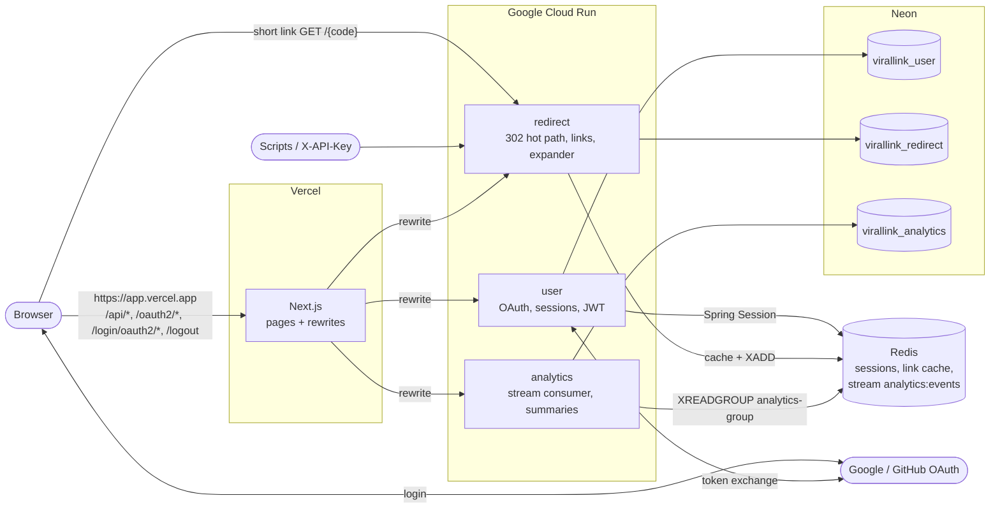

# Deploying Virallink

Target: **frontend on Vercel**, **PostgreSQL on Neon**, the **three Spring Boot services on Google Cloud Run**, and a
**Redis** whose provider is still open (see [Redis options](#redis-options)). Nothing in the repo deploys
automatically: the deploy workflow is manual (`workflow_dispatch`) and needs the one-time setup below.

Local development is unchanged: every new setting falls back to today's `localhost` value. See [LOCAL_DEV.md](./LOCAL_DEV.md).

- [Architecture](#architecture)
- [What the repo provides](#what-the-repo-provides)
- [Order of operations](#order-of-operations)
- [Environment variables](#environment-variables)
- [Neon (PostgreSQL)](#neon-postgresql)
- [Redis options](#redis-options)
- [OAuth (Google, GitHub)](#oauth-google-github)
- [Cloud Run](#cloud-run)
- [Vercel](#vercel)
- [GeoLite2 (analytics)](#geolite2-analytics)
- [CI/CD (GitHub Actions + Workload Identity Federation)](#cicd-github-actions--workload-identity-federation)
- [Smoke test after deploy](#smoke-test-after-deploy)
- [Known risks and open items](#known-risks-and-open-items)

---

## Architecture



Key points:

- **The browser only talks to the Vercel origin** (plus the redirect service for short links). API calls, the OAuth
  start (`/oauth2/authorization/*`) and the OAuth callback (`/login/oauth2/code/*`) all go through the Next.js
  rewrites in `viral-analytics-hub/next.config.ts`. That keeps the user service's `SESSION` cookie first-party on
  the Vercel domain, which is what `GET /api/v1/users/me` (session -> JWT) needs.
- Short links are served **directly** by the redirect service (its Cloud Run URL or a custom domain mapped to it),
  not through Vercel: lower latency, and the redirect service sees the real client IP.
- redirect and analytics share one Redis: redirect `XADD`s click events to `analytics:events`, analytics consumes them
  with the consumer group `analytics-group` and writes aggregates to Postgres.

## What the repo provides

| File | Purpose |
|------|---------|
| `*/src/main/resources/application.properties` | `${DB_URL}`, `${DB_USERNAME}`, `${DB_PASSWORD}`, `${REDIS_HOST}`, `${REDIS_PORT}`, `${REDIS_PASSWORD}`, `${REDIS_SSL}`, `${PORT}`, all with local defaults |
| `*/src/main/resources/application-prod.properties` | `SPRING_PROFILES_ACTIVE=prod`: small Hikari pool, no DEBUG logging, short shutdown, user: pinned OAuth redirect URI + Secure cookie |
| `user/Dockerfile`, `redirect/Dockerfile`, `analytics/Dockerfile` (+ `.dockerignore`) | Multi-stage: `eclipse-temurin:25-jdk-noble` builds with the service's `gradlew`, `eclipse-temurin:25-jre-noble` runs as non-root uid 10001 |
| `analytics/geoip/README.md` | Where the (git-ignored) GeoLite2 database goes |
| `.github/workflows/deploy-cloud-run.yml` | Manual build -> Artifact Registry -> Cloud Run, authenticated with Workload Identity Federation |
| `viral-analytics-hub/.env.example` | Vercel environment variables |

Images take **all configuration from environment variables at run time**; `.env`, `gradle.properties` and secrets are
excluded by `.dockerignore` and never copied. Docker builds skip tests (`-x test`); CI (`ci.yml`) runs them.

## Order of operations

1. **Pick names.** GCP project + region (e.g. `europe-west1`), the Vercel project name (gives `https://<project>.vercel.app`).
2. **Neon:** create the project and the three databases ([Neon](#neon-postgresql)).
3. **Redis:** provision it ([Redis options](#redis-options)).
4. **OAuth:** register the redirect URIs on the *Vercel* origin ([OAuth](#oauth-google-github)).
5. **GCP:** enable APIs, Artifact Registry, runtime service account, Secret Manager secrets ([Cloud Run](#cloud-run)).
6. **Build + first deploy** of user, redirect, analytics with all env vars and secrets. Note the three service URLs.
7. **Vercel:** import the repo (root `viral-analytics-hub`), set its env vars to those URLs, deploy ([Vercel](#vercel)).
8. **Optional:** set up WIF so later deploys are one click ([CI/CD](#cicd-github-actions--workload-identity-federation)).
9. [Smoke test](#smoke-test-after-deploy).

Cloud Run URLs are known after step 6 and the Vercel URL is predictable before its first deploy, so there is no
cycle. If you later add a custom domain on Vercel, update `FRONTEND_URL`, `NEXT_PUBLIC_API_BASE_URL` and both OAuth
redirect URIs, then redeploy.

## Environment variables

Secret = store in **Secret Manager** and attach with `--set-secrets`, never `--set-env-vars`. `PORT` is injected by
Cloud Run; do not set it.

### All three services

| Variable | Secret | Value |
|----------|:------:|-------|
| `SPRING_PROFILES_ACTIVE` | | `prod` |
| `DB_URL` | | per service, see below. Neon **direct** host, `?sslmode=require` |
| `DB_USERNAME` | | Neon role |
| `DB_PASSWORD` | yes | Neon role password |
| `DB_POOL_MAX_SIZE` | | optional, default `5` (prod profile) |
| `REDIS_HOST` / `REDIS_PORT` | | provider host / port |
| `REDIS_PASSWORD` | yes | empty = no AUTH |
| `REDIS_SSL` | | `true` for any Redis reached over the internet (Upstash) |
| `JWT_SECRET` | yes | **must be identical in user, redirect and analytics.** Base64, >= 32 bytes (`openssl rand -base64 32`) |

Instead of `REDIS_HOST/PORT/PASSWORD/SSL` you can set **`SPRING_DATA_REDIS_URL`** (supported by Spring Boot 4.1.1,
the version in `build.gradle`): `rediss://default:<password>@<host>:<port>` (`rediss` = TLS). It takes precedence
over the individual properties. Store it as a secret because it contains the password.

### user

| Variable | Secret | Value |
|----------|:------:|-------|
| `DB_URL` | | `jdbc:postgresql://<neon-direct-host>/virallink_user?sslmode=require` |
| `API_KEY_SIGNING_SECRET` | yes | **must be identical in user and redirect** (user signs API keys, redirect verifies them) |
| `FRONTEND_URL` | | `https://<project>.vercel.app`, no trailing slash. Used for CORS, post-login/logout/failure redirects, and as the OAuth redirect base |
| `OAUTH2_REDIRECT_BASE_URL` | | optional; defaults to `FRONTEND_URL`. Must be the origin the browser sees |
| `GOOGLE_CLIENT_ID` | | Google OAuth client |
| `GOOGLE_CLIENT_SECRET` | yes | |
| `GITHUB_CLIENT_ID` | | GitHub OAuth app (prod app) |
| `GITHUB_CLIENT_SECRET` | yes | |

Both OAuth registrations are **mandatory** as configured today: Spring Boot refuses to start with an empty client id.
To ship with only one provider, remove the other provider's lines from `user/.../application.properties`.

### redirect

| Variable | Secret | Value |
|----------|:------:|-------|
| `DB_URL` | | `jdbc:postgresql://<neon-direct-host>/virallink_redirect?sslmode=require` |
| `API_KEY_SIGNING_SECRET` | yes | same as user |
| `HASHIDS_SALT` | yes | `openssl rand -hex 16`. **Never change it** after launch: it invalidates every short code |
| `SAFE_BROWSING_API_KEY` | yes | optional; empty disables the expander's safety check |
| `SAFE_BROWSING_ENABLED` | | optional, default `true` |

### analytics

| Variable | Secret | Value |
|----------|:------:|-------|
| `DB_URL` | | `jdbc:postgresql://<neon-direct-host>/virallink_analytics?sslmode=require&reWriteBatchedInserts=true` (keep `reWriteBatchedInserts`: the sponge's batch inserts rely on it) |
| `GEOLITE_PATH` | | already set in the image to `/app/geoip/GeoLite2-City.mmdb`; override if you mount the file elsewhere |

analytics reads only `JWT_SECRET` for auth. It does **not** read `API_KEY_SIGNING_SECRET`, so `X-API-Key` works on
redirect only (LOCAL_DEV/HANDOVER previously said otherwise).

### Must match across services

| Value | Where |
|-------|-------|
| `JWT_SECRET` | user, redirect, analytics. A mismatch = silent 401s on redirect/analytics |
| `API_KEY_SIGNING_SECRET` | user, redirect |
| Redis instance | redirect and analytics must use the **same** Redis (the stream). user can use the same one |
| `FRONTEND_URL` (user) = `NEXT_PUBLIC_API_BASE_URL` (Vercel) = OAuth redirect URI origin | one public origin |

### Vercel (frontend)

All non-secret, all read at **build time** (changing one needs a redeploy). No trailing slashes.

| Variable | Value |
|----------|-------|
| `NEXT_PUBLIC_API_BASE_URL` | `https://<project>.vercel.app`: the Vercel origin itself, **not** the user service (see [Vercel](#vercel)) |
| `NEXT_PUBLIC_SHORT_LINK_BASE_URL` | redirect service URL, or your short domain mapped to it |
| `USER_SERVICE_URL` | `https://user-<hash>-<region>.a.run.app` (or `https://user-<project-number>.<region>.run.app`) |
| `REDIRECT_SERVICE_URL` | redirect Cloud Run URL |
| `ANALYTICS_SERVICE_URL` | analytics Cloud Run URL |

## Neon (PostgreSQL)

`infra/postgres/init-db.sh` only runs inside `docker compose`, so on Neon you create the databases yourself.

1. Create a Neon project in the region closest to your Cloud Run region (Neon runs on AWS/Azure: e.g. Cloud Run
   `europe-west3` Frankfurt <-> Neon `aws-eu-central-1`; `us-east4` <-> `aws-us-east-1`). Every query crosses clouds.
2. Create the databases, either in the console (Databases -> New database) or with `psql` on the **direct** connection
   string (Dashboard -> Connect, untick "Connection pooling"):

   ```bash
   psql "postgresql://<role>:<password>@<endpoint>.<region>.aws.neon.tech/neondb?sslmode=require" <<'SQL'
   CREATE DATABASE virallink_user;
   CREATE DATABASE virallink_redirect;
   CREATE DATABASE virallink_analytics;
   SQL
   ```

   One role owning all three is simplest; per-service roles (each owning its own database) are better isolation.
3. The tables are created by Hibernate on first start (`ddl-auto=update`, see [risks](#known-risks-and-open-items)).

**Direct vs pooled:** use the **direct** host (no `-pooler` in the hostname) for the services. `ddl-auto=update` runs
DDL on every start, and DDL / session state is what transaction-mode PgBouncer handles worst. The pools are small
(`maximum-pool-size=5`), so the direct connection limit is fine: worst case is (max instances of all services) x 5,
e.g. (3 + 5 + 1) x 5 = 45. Check that against your compute size's `max_connections` in Neon's docs. Switch to the
pooled host only if you scale out a lot, and then move schema changes to a migration step on the direct host.

JDBC form: `jdbc:postgresql://<endpoint>.<region>.aws.neon.tech/<db>?sslmode=require` with `DB_USERNAME` /
`DB_PASSWORD` set separately (do not embed credentials in `DB_URL`).

Neon's free tier suspends an idle compute after a few minutes; the first query afterwards waits for it to wake (and
Hikari replaces the dropped connections). The Cloud Run probes below only hit liveness/readiness, which do not touch
the database, so they do not keep Neon awake. The analytics sponge only touches Postgres when there are events.

## Redis options

What the app needs from Redis, whichever provider:

- **Streams with consumer groups**: `XADD` (with `MAXLEN ~`), `XGROUP CREATE ... MKSTREAM`, `XREADGROUP`, `XACK`, `XDEL`.
- **Persistence** (AOF or RDB): un-sponged click events and login sessions live only in Redis.
- **No eviction of keys without TTL**: `noeviction` or a `volatile-*` policy. Under `allkeys-*` Redis may evict the
  stream or consumer group, i.e. lose clicks.
- **AUTH + TLS** when reached over the internet. No `CONFIG` command is needed: Spring Session uses the non-indexed
  repository (`spring.session.data.redis.repository-type=default`), which never runs `CONFIG SET notify-keyspace-events`.

**Command volume:** the analytics sponge polls every 500 ms with two `XREADGROUP`s, about **4 commands/s, ~10.4
million/month with zero traffic**. On top: about 4 commands per click (cache read, `INCR`, `XADD`, and the sponge's
`XACK`/`XDEL` per batch), plus session reads/writes on every user-service request.

| Option | Cost (check current pricing) | Notes |
|--------|------------------------------|-------|
| **Upstash** free | $0 | 500K commands/month: the idle sponge alone burns it in about **1.5 days**. Not viable |
| **Upstash** pay-as-you-go | ~$0.20 / 100K commands -> **~$21/month idle** | Grows with traffic |
| **Upstash** fixed plan | **~$10/month** (smallest) | No per-command billing; the realistic Upstash choice. TLS required (`REDIS_SSL=true`); Streams + consumer groups supported; data persisted. Leave eviction off |
| **Memorystore for Redis** (Basic, 1 GB) | **~$36/month** minimum | Private IP only: Cloud Run needs Direct VPC egress (no extra cost) or a Serverless VPC Access connector (extra). Enable AUTH; in-transit TLS uses a Google-managed CA you'd have to add to the JVM truststore (`spring.data.redis.ssl.bundle`), so AUTH without TLS inside the VPC is the simpler start. Enable RDB persistence. Default `volatile-lru` is OK |
| **Small VM** (e.g. `e2-micro`, Redis 7) | ~$0 (one free-tier e2-micro in some US regions) to a few $/month | You own patching, backups, monitoring. Use `appendonly yes`, `requirepass`, `maxmemory-policy noeviction`, reach it over the VPC (Direct VPC egress), never expose it publicly |

Suggestion for a portfolio MVP: Upstash fixed plan (least ops) or the VM (cheapest). Memorystore when it needs to be
production-grade. All three work with the same env vars.

Security note: Spring Session stores Java-serialized objects in Redis, so anyone who can write to that Redis can
attack the user service. Keep it private and authenticated.

## OAuth (Google, GitHub)

The OAuth redirect URI is on the **Vercel origin**, not on the user service's Cloud Run URL:

```
https://<project>.vercel.app/login/oauth2/code/google
https://<project>.vercel.app/login/oauth2/code/github
```

Why: the browser must come back to the origin that holds the `SESSION` cookie set when login started (the cookie
carries the OAuth `state`). Login starts on the Vercel origin (`NEXT_PUBLIC_API_BASE_URL`), so it must return there;
Vercel then proxies `/login/oauth2/*` to the user service. The prod profile pins this URI
(`OAUTH2_REDIRECT_BASE_URL`, default `FRONTEND_URL`) instead of deriving `{baseUrl}` from forwarded headers, so it does
not depend on which Host/X-Forwarded-Host headers survive Vercel -> Cloud Run. (Spring Security 7.1 only checks
`state` on the callback and reuses the stored redirect URI for the token exchange, so the pinned value is all that
matters.)

**Google** (console.cloud.google.com -> APIs & Services):

1. OAuth consent screen: app name, support email; scopes `openid`, `email`, `profile` (no verification needed for
   these). While the app is in "Testing", only listed test users can sign in; publish it for public sign-in.
2. Credentials -> Create credentials -> OAuth client ID -> Web application. Authorized redirect URI:
   `https://<project>.vercel.app/login/oauth2/code/google`. A separate prod client is cleaner than adding the URI to
   the dev client (whose URI is `http://localhost:8080/login/oauth2/code/google`).
3. `GOOGLE_CLIENT_ID` (env) and `GOOGLE_CLIENT_SECRET` (Secret Manager) on the user service.

**GitHub:** an OAuth App has exactly **one** callback URL (redirect URIs must be on its host), so create a **second
OAuth App for production** (github.com/settings/developers -> New OAuth App):

- Homepage URL: `https://<project>.vercel.app`
- Authorization callback URL: `https://<project>.vercel.app/login/oauth2/code/github`
- `GITHUB_CLIENT_ID` / `GITHUB_CLIENT_SECRET` from that app.

Vercel **preview deployments** cannot log in: their URLs are not registered redirect URIs and `FRONTEND_URL` points
at production.

## Cloud Run

### One-time GCP setup

```bash
PROJECT=<project-id>; REGION=europe-west1; REPO=virallink
gcloud config set project $PROJECT
gcloud services enable run.googleapis.com artifactregistry.googleapis.com secretmanager.googleapis.com \
  iam.googleapis.com iamcredentials.googleapis.com sts.googleapis.com

gcloud artifacts repositories create $REPO --repository-format=docker --location=$REGION

# Runtime identity for the three services (reads secrets, nothing else)
gcloud iam service-accounts create virallink-run --display-name="Virallink Cloud Run runtime"
RUN_SA=virallink-run@$PROJECT.iam.gserviceaccount.com

# Secrets (repeat for each; printf avoids a trailing newline)
printf '%s' "$(openssl rand -base64 32)" | gcloud secrets create jwt-secret --data-file=-
printf '%s' "$(openssl rand -base64 32)" | gcloud secrets create api-key-signing-secret --data-file=-
printf '%s' "$(openssl rand -hex 16)"    | gcloud secrets create hashids-salt --data-file=-
printf '%s' '<neon password>'            | gcloud secrets create db-password --data-file=-
printf '%s' '<redis password>'           | gcloud secrets create redis-password --data-file=-
printf '%s' '<google secret>'            | gcloud secrets create google-client-secret --data-file=-
printf '%s' '<github secret>'            | gcloud secrets create github-client-secret --data-file=-
for s in jwt-secret api-key-signing-secret hashids-salt db-password redis-password google-client-secret github-client-secret; do
  gcloud secrets add-iam-policy-binding $s --member=serviceAccount:$RUN_SA --role=roles/secretmanager.secretAccessor
done
```

### Build and push (first time, from a machine with Docker; later via the workflow)

```bash
gcloud auth configure-docker $REGION-docker.pkg.dev
TAG=$(git rev-parse --short HEAD)
for s in user redirect analytics; do
  docker build -t $REGION-docker.pkg.dev/$PROJECT/$REPO/$s:$TAG ./$s
  docker push $REGION-docker.pkg.dev/$PROJECT/$REPO/$s:$TAG
done
```

(On Apple Silicon add `--platform linux/amd64`. Or build in GCP: `gcloud builds submit ./user --tag ...`.)

### First deploy (sets env vars + secrets; later deploys keep them)

```bash
IMG=$REGION-docker.pkg.dev/$PROJECT/$REPO
NEON_HOST=<endpoint>.<region>.aws.neon.tech
COMMON_ENV="SPRING_PROFILES_ACTIVE=prod,DB_USERNAME=<neon role>,REDIS_HOST=<redis host>,REDIS_PORT=6379,REDIS_SSL=true"
COMMON_SECRETS="DB_PASSWORD=db-password:latest,REDIS_PASSWORD=redis-password:latest,JWT_SECRET=jwt-secret:latest"

gcloud run deploy user --image=$IMG/user:$TAG --region=$REGION --service-account=$RUN_SA \
  --allow-unauthenticated --memory=1Gi --cpu=1 --cpu-boost --cpu-throttling --min-instances=0 --max-instances=3 \
  --set-env-vars="$COMMON_ENV,DB_URL=jdbc:postgresql://$NEON_HOST/virallink_user?sslmode=require,FRONTEND_URL=https://<project>.vercel.app,GOOGLE_CLIENT_ID=<id>,GITHUB_CLIENT_ID=<id>" \
  --set-secrets="$COMMON_SECRETS,API_KEY_SIGNING_SECRET=api-key-signing-secret:latest,GOOGLE_CLIENT_SECRET=google-client-secret:latest,GITHUB_CLIENT_SECRET=github-client-secret:latest"

gcloud run deploy redirect --image=$IMG/redirect:$TAG --region=$REGION --service-account=$RUN_SA \
  --allow-unauthenticated --memory=1Gi --cpu=1 --cpu-boost --cpu-throttling --min-instances=1 --max-instances=5 \
  --set-env-vars="$COMMON_ENV,DB_URL=jdbc:postgresql://$NEON_HOST/virallink_redirect?sslmode=require" \
  --set-secrets="$COMMON_SECRETS,API_KEY_SIGNING_SECRET=api-key-signing-secret:latest,HASHIDS_SALT=hashids-salt:latest"

gcloud run deploy analytics --image=$IMG/analytics:$TAG --region=$REGION --service-account=$RUN_SA \
  --allow-unauthenticated --memory=1Gi --cpu=1 --cpu-boost --no-cpu-throttling --min-instances=1 --max-instances=1 \
  --set-env-vars="$COMMON_ENV,DB_URL=jdbc:postgresql://$NEON_HOST/virallink_analytics?sslmode=require&reWriteBatchedInserts=true" \
  --set-secrets="$COMMON_SECRETS"
```

`--allow-unauthenticated` is required: Vercel's rewrites and short-link clicks are anonymous HTTP calls, and the apps
enforce auth themselves (JWT / session). If an org policy blocks `allUsers`, ask for an exception for these services.

### Settings per service

| | user | redirect | analytics |
|---|---|---|---|
| Billing | request-based (`--cpu-throttling`) | request-based (see note) | **instance-based (`--no-cpu-throttling`)** |
| min instances | 0 (scale to zero) | **1** (no JVM cold start on the hot path) | **1** |
| max instances | e.g. 3 | e.g. 5 | **1** |
| memory / CPU | 1 GiB / 1 | 1 GiB / 1 | 1 GiB / 1 |
| Startup CPU boost | on | on | on |

- **analytics** is a Redis Streams consumer driven by `@Scheduled`, not by requests. With request-based billing its
  CPU is throttled between requests and the sponge stalls, so it needs instance-based billing and at least one
  instance. **Exactly one**: the consumer name is a constant (`analytics-sponge-1`), and two instances with the same
  name would re-read each other's pending entries and double-count clicks. Scaling out needs a per-instance consumer
  name plus `XAUTOCLAIM` for dead consumers. This always-on instance is the main fixed cost (roughly $40-50/month for
  1 vCPU + 1 GiB on instance-based pricing; check the Cloud Run pricing page and its free tier).
- **redirect:** min-instances=1 avoids the 15-30 s JVM cold start on short links (measured: ~17 s to start with
  1 vCPU / 512 MiB locally; CPU boost helps). Note: the click event is published `@Async` **after** the 302 is sent.
  Under request-based billing Cloud Run does not guarantee CPU after the response; the publish takes milliseconds and
  normally completes, but if clicks go missing, switch redirect to `--no-cpu-throttling` (higher cost).
- **user** can scale to zero: sessions are in Redis, so no state is lost; the first login after idle waits for a cold start.
- **Memory:** idle RSS measured locally is ~260 MiB under a 512 MiB limit and ~360-400 MiB unconstrained. 512 MiB
  works; 1 GiB leaves headroom. The images set `-XX:MaxRAMPercentage=75`, so the heap follows the limit. Extra JVM
  flags: `JDK_JAVA_OPTIONS`.
- **Probes:** Cloud Run's default TCP startup probe works (Tomcat opens the port when the context is ready). To use
  HTTP: startup `/actuator/health/readiness`, liveness `/actuator/health/liveness` (both public, both skip DB/Redis).
- **Shutdown:** the prod profile caps graceful shutdown at 8 s (Cloud Run kills 10 s after SIGTERM).

### Behind Cloud Run's proxy (HTTPS, X-Forwarded-*)

Cloud Run terminates TLS and forwards plain HTTP with `X-Forwarded-Proto: https` / `X-Forwarded-For`. Its front end
connects from `169.254.0.0/16`, which is in Tomcat's default trusted internal-proxy list, so with
`server.forward-headers-strategy=native` (redirect, and now user) `request.isSecure()` is true and `getRemoteAddr()`
is the client IP.

- **user:** `forward-headers-strategy=native` added. The OAuth redirect URI is pinned anyway (above). The prod profile
  also forces `server.servlet.session.cookie.secure=true`, so the `SESSION` cookie is
  `Secure; HttpOnly; SameSite=Lax` even if a hop drops `X-Forwarded-Proto` (`Lax` is right: everything is same-origin
  on Vercel and the OAuth return is a top-level GET). Success, failure and logout redirects are absolute
  `FRONTEND_URL` URLs. CORS allows exactly `FRONTEND_URL`, but browsers never call the service cross-origin (it is all
  same-origin through Vercel), so CORS is not on the critical path.
- **redirect:** already had `native`; the click IP comes from `X-Forwarded-For`. **Verify after the first deploy**
  that stored IPs (anonymized `a.b.c.0`) are client IPs and not Google front-end addresses; if not, set
  `server.tomcat.remoteip.trusted-proxies` for the extra hop.
- **analytics:** not needed. It builds no redirect URLs and gets client IPs from the stream, not the request.

Verified locally (prod profile, password-protected Redis, Host header set to a Cloud Run URL, `X-Forwarded-Proto: https`):
OAuth start returns `redirect_uri=https://<vercel>/login/oauth2/code/google` and a Secure `SESSION` cookie stored in
Redis; the callback still finds the OAuth state after the container is restarted; a failed login and logout
redirect to the Vercel `/login`; `X-Forwarded-For: 203.0.113.77` is stored as `203.0.113.0`.

## Vercel

1. Import the GitHub repo. **Root Directory:** `viral-analytics-hub`. Framework preset: Next.js. pnpm is detected
   from `pnpm-lock.yaml`. Set Node.js to **22.x** (what CI uses).
2. Environment variables (Production): see [the table above](#vercel-frontend) and `viral-analytics-hub/.env.example`.
3. Deploy. Any change to those variables needs a **redeploy**: `NEXT_PUBLIC_*` are inlined into the bundle and the
   `*_SERVICE_URL` rewrites are written into the routes manifest at build time.

`next.config.ts` has **no `output: "standalone"`** (HANDOVER said it did; that setting was lost in an earlier merge).
Vercel does not need it, so it was deliberately not re-added.

**Rewrites with https Cloud Run URLs** work as-is: verified with `pnpm build` using `https://...a.run.app` values
(trailing slashes are now stripped). Vercel proxies external rewrites server-side, forwarding `Cookie` and returning
`Set-Cookie` and `Location` unchanged, which is what the login flow needs:

1. Browser -> `https://<vercel>/oauth2/authorization/google` (`NEXT_PUBLIC_API_BASE_URL` = Vercel origin) -> rewrite
   -> user service: stores the OAuth state in the Redis session, answers `302` to Google + `Set-Cookie: SESSION`
   (first-party, on the Vercel domain).
2. Google -> `https://<vercel>/login/oauth2/code/google` -> rewrite -> user service (cookie included): token
   exchange, `302` to `FRONTEND_URL`.
3. App -> `GET /api/v1/users/me` (cookie) -> rewrite -> JWT in the response, kept in memory, sent as Bearer to
   `/api/v1/links/*` and `/api/v1/analytics/*` (rewrites to redirect / analytics).
4. Logout: `POST /logout` -> rewrite -> session invalidated, `302` to `FRONTEND_URL/login`.

Why `NEXT_PUBLIC_API_BASE_URL` must be the Vercel origin: the login page links to
`${NEXT_PUBLIC_API_BASE_URL}/oauth2/authorization/...`. Pointed at the user service's Cloud Run URL, the `SESSION`
cookie would land on `*.run.app`, and `/api/v1/users/me` on the Vercel domain would never see it: every login would
"succeed" and then 401. (Locally `http://localhost:8080` works only because cookies ignore ports.)

The first request after the user service scaled to zero waits for a JVM start (15-30 s) through the rewrite; set
`--min-instances=1` on user if that is too slow for you.

## GeoLite2 (analytics)

The `.mmdb` is git-ignored and must not be committed (MaxMind license). Current behavior was checked and verified:
if the file is missing, analytics starts normally, logs
`GeoLite database not found at /app/geoip/GeoLite2-City.mmdb. Geo enrichment disabled.`, and records country/city
as `Unknown` (verified by running the image without the file).

Two ways to supply it:

- **Bake it in CI (implemented, optional):** add the repository variable `MAXMIND_ACCOUNT_ID` and secret
  `MAXMIND_LICENSE_KEY`. The deploy workflow downloads GeoLite2-City into `analytics/geoip/` before `docker build`,
  and the Dockerfile copies `geoip/` into the image. Without the key it builds without the database. Locally: drop
  `GeoLite2-City.mmdb` into `analytics/geoip/` before `docker build`. The image then contains the database, so keep
  the registry private.
- **Mount at run time:** upload the file to a private Cloud Storage bucket and mount it:

  ```bash
  gcloud run services update analytics --region=$REGION --execution-environment=gen2 \
    --add-volume=name=geoip,type=cloud-storage,bucket=<bucket>,readonly=true \
    --add-volume-mount=volume=geoip,mount-path=/geoip \
    --update-env-vars=GEOLITE_PATH=/geoip/GeoLite2-City.mmdb
  ```

  The runtime service account needs `roles/storage.objectViewer` on the bucket. Updating the database = upload a new
  file + restart (new revision), no image rebuild. The file is read once at startup.

**License (MaxMind GeoLite2 EULA, check the current text):** a free account and license key are required to
download; attribution to MaxMind is required wherever the data is shown; no public redistribution of the database;
keep it up to date (MaxMind publishes updates twice a week and expects outdated copies to be replaced).

## CI/CD (GitHub Actions + Workload Identity Federation)

`.github/workflows/deploy-cloud-run.yml` is **manual only** (`workflow_dispatch`, choose `all` / one service). It
builds the image with the service's Dockerfile, pushes `<region>-docker.pkg.dev/<project>/<repo>/<service>:<sha>`,
and runs `gcloud run deploy` with the image plus the scaling flags from the table above. Env vars and secrets from the
first deploy are kept. `ci.yml` is unchanged.

Authentication is GitHub OIDC -> Workload Identity Federation: no service-account JSON keys.

```bash
PROJECT_NUMBER=$(gcloud projects describe $PROJECT --format='value(projectNumber)')
GH_REPO=ehdro06/viral-analytics-hub

gcloud iam workload-identity-pools create github --location=global --display-name="GitHub Actions"
gcloud iam workload-identity-pools providers create-oidc viral-analytics-hub \
  --location=global --workload-identity-pool=github \
  --issuer-uri="https://token.actions.githubusercontent.com" \
  --attribute-mapping="google.subject=assertion.sub,attribute.repository=assertion.repository,attribute.ref=assertion.ref" \
  --attribute-condition="assertion.repository=='$GH_REPO' && assertion.ref=='refs/heads/main'"

gcloud iam service-accounts create github-deployer --display-name="GitHub Actions deployer"
DEPLOY_SA=github-deployer@$PROJECT.iam.gserviceaccount.com
gcloud projects add-iam-policy-binding $PROJECT --member=serviceAccount:$DEPLOY_SA --role=roles/run.developer
gcloud artifacts repositories add-iam-policy-binding $REPO --location=$REGION \
  --member=serviceAccount:$DEPLOY_SA --role=roles/artifactregistry.writer
gcloud iam service-accounts add-iam-policy-binding $RUN_SA \
  --member=serviceAccount:$DEPLOY_SA --role=roles/iam.serviceAccountUser
gcloud iam service-accounts add-iam-policy-binding $DEPLOY_SA --role=roles/iam.workloadIdentityUser \
  --member="principalSet://iam.googleapis.com/projects/$PROJECT_NUMBER/locations/global/workloadIdentityPools/github/attribute.repository/$GH_REPO"
```

The attribute condition only lets runs from `main` of this repo authenticate (runs dispatched on other branches fail
at the auth step), so remove the `ref` part if you want to deploy branches.

Then set repository **variables**: `GCP_PROJECT_ID`, `GCP_REGION`, `GCP_ARTIFACT_REPO`,
`GCP_WORKLOAD_IDENTITY_PROVIDER` (`projects/<number>/locations/global/workloadIdentityPools/github/providers/viral-analytics-hub`),
`GCP_DEPLOY_SERVICE_ACCOUNT`, and optionally `MAXMIND_ACCOUNT_ID` + secret `MAXMIND_LICENSE_KEY`.

The frontend needs no workflow: Vercel's Git integration deploys on push to `main` (and builds previews for PRs).

## Smoke test after deploy

1. `curl https://<user-url>/actuator/health` (and redirect, analytics): `{"status":"UP"}`.
2. Open `https://<vercel>/login`, sign in with Google and with GitHub; you land on `/dashboard`.
   DevTools -> Application -> Cookies: `SESSION` on the **Vercel** domain, `Secure`, `HttpOnly`.
3. Create a link, open the short URL in a private window: 302 to the target.
4. Within a few seconds the dashboard counts it. In the analytics logs: `Sponged 1 events`.
5. Check the stored IP is yours (anonymized), not a Google address (`select ip_address from link_analytics order by id desc limit 1;`).
6. Settings -> create an API key -> `curl -H "X-API-Key: <key>" https://<redirect-url>/api/v1/links` works.
7. Log out: back on `/login`, and `/api/v1/users/me` returns 401.

## Known risks and open items

- **`spring.jpa.hibernate.ddl-auto=update` in production** (all three services; deliberately **not changed**):
  every instance start may `ALTER` the live schema, concurrently if several instances start at once. It never drops
  or renames columns, and a bad entity change cannot be rolled back. Once the schema is stable set
  `SPRING_JPA_HIBERNATE_DDL_AUTO=validate` per service and introduce Flyway/Liquibase migrations.
- **analytics cannot scale out** (fixed consumer name, see above). Keep `--max-instances=1`.
- **Spring Session was not active before this change.** `user/build.gradle` depended on bare
  `spring-session-data-redis`; in Boot 4 the auto-configuration lives in separate modules, so sessions silently stayed
  in Tomcat memory (`JSESSIONID`) and `spring.session.*` was ignored. On Cloud Run that would break logins whenever
  the OAuth callback hit another instance and log everyone out on scale-to-zero. Now `spring-boot-starter-session-data-redis`.
  Existing local sessions are not migrated (everyone logs in once more).
- **JWT lifetime** is 24 h with no revocation; logout only kills the session.
- **Dead code** from an earlier auth design: `OAuth2LoginSuccessHandler` (not wired into `SecurityConfig`) and the
  `/auth/callback` page. The live flow is session cookie -> `/api/v1/users/me` -> JWT.
- Docker Hub rate limits: Cloud Build and GitHub runners usually pull fine; if not, the same images are on
  `mirror.gcr.io/library/eclipse-temurin:25-{jdk,jre}-noble`.
